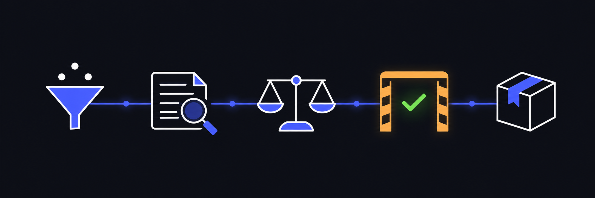

<p align="center">
  
</p>

<h1 align="center">sw-dev-loadout</h1>

<p align="center"><b>一组 Agent Skill（8 份）：什么时候做什么、凭什么算合格、怎么落地。</b></p>

<p align="center">
  <a href="#八份各管什么">八份各管什么</a> ·
  <a href="#安装">安装</a> ·
  <a href="#它有多少证据">证据</a>
</p>

<p align="center">
  <a href="https://agentskills.io"></a>
</p>

<br>

面向任何软件项目，不绑定某个仓库——仓库专属的脚本名、目录约定与界面常量都留在源材料里，没有带进来。

## 八份各管什么

| skill | face | domain | 介绍 |
|---|---|---|---|
| [delivery-loop](skills/delivery-loop/SKILL.md) | `process` |  软件开发 | 一轮交付怎么推进、交接、算完 |
| [review-gate](skills/review-gate/SKILL.md) | `process` |  软件开发 | 评审流水线与风险归口 |
| [engineering-standards](skills/engineering-standards/SKILL.md) | `quality` |  软件开发 | 约定的硬化、分层与门禁 |
| [contract-prose](skills/contract-prose/SKILL.md) | `quality` |  文档 | 散文只写契约 |
| [failure-handling](skills/failure-handling/SKILL.md) | `quality` |  软件开发 | 失败路径设计 |
| [change-evidence](skills/change-evidence/SKILL.md) | `quality` |  软件开发 | 改动该跑什么证据 |
| [readme-writing](skills/readme-writing/SKILL.md) | `quality` |  文档 | README 的读者优先判据 |
| [change-landing](skills/change-landing/SKILL.md) | `execution` |  软件开发 | 提交、推送、落地 PR |

一条核心断言贯穿全组：**约定除非有程序会拒绝违规，否则等于不存在。**

## 安装

推荐 skit：

```sh
skit install vlln/sw-dev-loadout/skills/delivery-loop vlln/sw-dev-loadout/skills/review-gate      # 流程
skit install vlln/sw-dev-loadout/skills/engineering-standards vlln/sw-dev-loadout/skills/contract-prose vlln/sw-dev-loadout/skills/failure-handling vlln/sw-dev-loadout/skills/change-evidence vlln/sw-dev-loadout/skills/readme-writing   # 质量
skit install vlln/sw-dev-loadout/skills/change-landing                           # 执行
skit check
```

生态通用 CLI（需 Node.js ≥ 22.20）：

```sh
npx skills add vlln/sw-dev-loadout --skill readme-writing    # 例；换 --skill 装别的
```

什么都没装时，把这段直接发给 agent，让它自己装自己用：

```text
Run `npx skills use "vlln/sw-dev-loadout@readme-writing"` and follow the generated skill instructions now. Read its complete output, redirecting it to a temporary file first if necessary. Resolve relative paths from the supporting-files directory it provides.
```

本地开发时克隆后用 `./skills/<名>` 直装。八份互不引用，装一份也能用。一个任务加载哪几份由任务决定，不需要装全。

跑通的样子：`skit list` 里出现刚装的几份，且 `skit check` 没有指向它们的报错。

## 它有多少证据

五轮同题对照，两个互不知情的 agent，同一输入，只差可用材料：

| 轮 | 任务 | 结果 |
|---|---|---|
| 1 | 审一份埋了 11 个问题的 diff | **打平**，两组都命中 6 个阻断项、零误报 |
| 2 | 为一个小 CLI 写实施计划 | 流程与落地更完整（4 个 PR 带依赖序与逐 PR 回退），代价是篇幅翻倍（336 vs 167 行） |
| 3 | 把第二轮的计划交给另一个 agent 执行 | 计划骨架成立、34 个用例全绿，但执行时撞上 16 处问题含 4 处自相矛盾 |
| 4 | 换夹具（Python / 85 行 / 四条小需求）复验前几轮逼出的规则 | 处理组给每条新用例预判旧版本结果；基线有两条新用例在旧版本上就通过而未被发现 |
| 5 | 换大夹具（Go / 403 行 / 7 条需求）验「按规模裁剪」 | 预言的过度拆分两组都没犯；两组都自己找到一处没埋的溢出缺陷；执行阶段双双中止，主证据是计划 |

**这组 skill 的作用是让纪律成为默认，不是让判断变聪明。** 第一轮说明质量面的判断力在原始材料里已经足够；真正的增益在流程与落地的完整性上，风险是过度流程。

前四轮各逼出一条规则：按规模裁剪流程、切片看爆炸半径、新证据必须在改动前的版本上真跑一遍、照做前先判要求在所有分支上是否可满足。第五轮没有逼出新规则，它改变的是证据结构：

其中"新证据要在旧版本上真跑"已在两个夹具上复现，算确认，但第五轮基线自己也做到了，差分在消失；"按规模裁剪"在第五轮有了失败的机会而失败没来，仍是候选，但和"没给过机会"不是一回事。

夹具与每一轮的原始产出都在仓库里：[fixtures/](fixtures/)、[docs/runs/](docs/runs/)。结论与它有多硬见 [docs/experiment.md](docs/experiment.md)——每轮只跑过一次，补的规则都只被一个夹具逼出来过。

## 文档

| 路径 | 是什么 |
|---|---|
| [docs/plan.md](docs/plan.md) | 地图与取舍：七份怎么分、哪些材料合并、哪些丢弃、为什么 |
| [docs/experiment.md](docs/experiment.md) | 五轮对照的度量、结论与限制 |
| [docs/readme/](docs/readme/) | readme-writing 自己的一条证据线：同一 README 四次产出 354→372→148→140 行 |
| [fixtures/](fixtures/) | 实验输入：自检方法与已知缺陷 |
| [docs/runs/](docs/runs/) | 保存下来的原始产出，含第三轮结果的 git bundle |
| [docs/v1/](docs/v1/) | 冻结的第一版，用于对照后续改动 |

## 许可

MIT
